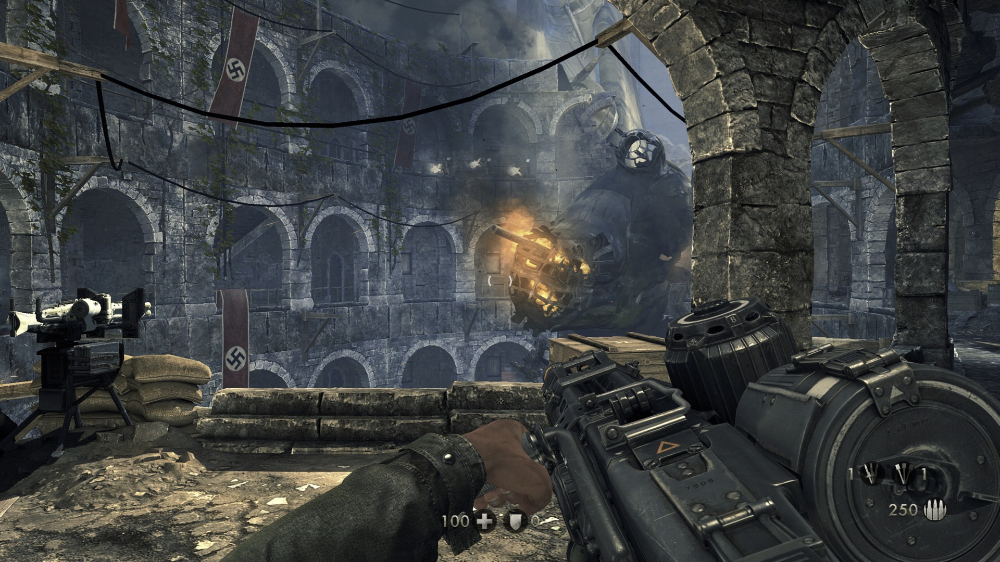

# Wolfenstein: The New Order Recomp

**Wolfenstein: The New Order Recomp** is a native Apple Silicon port of **Wolfenstein: The New Order**
(MachineGames, 2014), made by statically recompiling the original Windows release.

The New Order never had a Mac version. This project translates the game's own 64-bit Windows executable and its
code DLLs, function by function, into C and compiles them for arm64, so id Tech 5 runs natively on macOS with no
Wine, no Rosetta and no x86 emulation at run time. The engine and game code run unchanged. The parts that talked to
Windows (windows and input, files, threads, audio, networking, Steam) are replaced with native implementations, and
the game's OpenGL renderer runs on macOS's own OpenGL, which on Apple Silicon is built on Metal.

This is an unofficial community project. It is not affiliated with or endorsed by MachineGames, id Software,
Bethesda or ZeniMax. **You need your own copy of the game**: none of the game's code or data files are included in
this repository.

## Playing on macOS

  1. Install the **Windows** version of **Wolfenstein: The New Order** through Steam, either in the Steam for Mac
     client or with Steam for Windows in [CrossOver](https://www.codeweavers.com/crossover). Make sure the game is
     fully downloaded and updated.
  2. Download `Wolfenstein-TNO-Recomp-macOS.dmg` from the [Releases](https://github.com/NightSightProductions/Wolfenstein-TNO-Recomp/releases) page.
  3. Open it and run **Install Wolfenstein Recomp**. The installer finds your copy of the game, checks that it is the
     supported release, and builds the game on your Mac. The build takes about 5 minutes, needs about 1.5 GB of
     temporary disk space, an internet connection and Apple's Command Line Tools (the installer offers to install
     them).
  4. Launch **Wolfenstein: The New Order** from your Applications folder.

Note: release builds are not notarized by Apple yet, so macOS blocks the installer the first time it is opened. To
allow it, go to **System Settings > Privacy & Security** and click **Open Anyway**.

To build from source instead, see [Build Instructions](#build-instructions).

Some things worth knowing:
  - Saved games and settings are stored in `~/Library/Application Support/wolfnew-recomp`. The game data is read
    from your Steam installation, which is never modified.
  - The game doesn't use Steam Cloud, so saves stay on this Mac. With the Steam for Mac client running and logged in,
    the game signs in, loads its stats and unlocks achievements through the client's `libsteam_api.dylib`; without
    Steam, it runs offline.
  - The fullscreen resolutions in the game's Video settings are scaled to your screen; windowed mode opens a window
    of the chosen size.
  - The app contains code translated from your copy of the game. Don't share it; share this repository instead, so
    others build it from their own copy.

### Steam Play (optional, needs NotProton)

Steam for Mac has the same compatibility-tool support as Steam on Linux, but it is switched off.
[NotProton](https://github.com/NotProtonNot/NotProton) switches it on. With NotProton installed, the installer's
**Steam Play: NSR** option (off by default) registers the game with **NightSight Recomp (NSR)**, NightSightProductions'
one Steam Play tool for all its recomps; from a source build, `make steam-play` does the same (pass
`APP_PATH="/Applications/Wolfenstein The New Order.app"` for an installed app). Restart Steam, then choose it under
**Wolfenstein: The New Order > Properties > Compatibility > Force the use of a specific Steam Play compatibility
tool > NightSight Recomp (NSR)**. Play on the game's own library entry then starts the native app on the Windows
release Steam installed, with the Steam overlay and playtime. NotProton plugins switched on for the game in its
options are loaded into it too.

Leave the game's Steam launch options empty: with a tool other than NotProton's own, Steam for Mac can't start a
launch that has them ("OS Error 260"). Settings for the game, such as turning a NotProton plugin on, go into NSR
instead, for example `python3 framework/tools/nsr.py set-env --appid 201810 NOTPROTON_<PLUGIN>=1`.

Without NotProton the tool does nothing. Each launch is logged to `~/Library/Logs/nsr.log`. The installer's
uninstaller removes the game's NSR entry and keeps the tool for other games.

## How It Works

The port is built on [Recomp-Framework](https://github.com/NightSightProductions/Recomp-Framework),
NightSightProductions' static recompiler, included as the `framework/` submodule (clone with
`git clone --recursive`, or run `git submodule update --init`). Its OpenGL backend was written for this port.

  - **The executable.** The Steam release's `WolfNewOrder_x64.exe` is wrapped in SteamStub: its code section is
    encrypted until the wrapper decrypts it at startup, so it can't be translated as shipped.
    `tools/unwrap_steamstub.py` does that decryption once, at build time, on your copy. The game still signs in
    through the real Steam client.
  - **Translation.** The framework's translator (`framework/tools/recomp64.py`) turns the executable and its two
    code DLLs (`superscriptx64.dll`, the script VM, and `bink2w64.dll`, the video codec) into C: about 49,000
    functions that run against the original x86-64 register state, with guest memory at the addresses the game
    expects. SSE becomes NEON, and Bink's hand-written MMX is translated too.
  - **Runtime.** The framework's runtime (`framework/runtime/`) re-implements the Windows APIs the game imports:
    kernel32, user32 windows and messages on AppKit, DirectInput and XInput, XAudio2 on CoreAudio (with submix
    routing), Winsock, and a Steam layer that bridges to Steam for Mac.
  - **OpenGL.** `framework/runtime/opengl.m` runs WGL on macOS's OpenGL 4.1 core profile. The game asks for a
    compatibility context, so the layer:
    - emulates the window's framebuffer and presents it through Metal;
    - lists the extensions the engine checks for;
    - shares occlusion-query names across contexts, as Windows drivers do;
    - stores legacy alpha/luminance textures as swizzled red/green ones.
  - **Steam Play.** `framework/tools/nsr.py` is the NightSight Recomp tool; Steam starts the app with the exe path
    and game folder, and the app loads its bundled image in place of the encrypted exe.
  - **This repository** holds what is specific to the game:
    - `src/game.c`: the game's settings for the runtime (executable, folders, Steam app ID, bundled image, GL
      extensions);
    - `src/native_wolf.c`: native replacements for routines in the executable (`fmodf`, which the original computes
      with x87 instructions);
    - `src/imports_wolf.c`: the CUDA runtime's registration calls. There is no CUDA on a Mac, so the engine uses its
      CPU path to transcode virtual textures;
    - `tools/unwrap_steamstub.py` and `scripts/build.sh`.

## License

The code in this repository is licensed under the terms of the **MIT License**. You can find the entire license in
the [LICENSE](LICENSE) file.

**Wolfenstein: The New Order**, its executable, DLLs and data remain the property of their respective owners. The C
code that the build generates from the game's code (`gen/`, `gen_superscript/`, `gen_bink/`), the unwrapped
executable and the built app are derived from the game and **must not be redistributed**; the repository is set up
so that they are never committed.

The Wolfenstein logo and screenshots are shown only to identify the game; the logo is a trademark of its respective
owners.

## Features

  - Native Apple Silicon (arm64) build of the original Windows release, with the original engine code
  - The campaign, with Bink cutscenes, music and sound
  - OpenGL rendering on macOS's OpenGL (Metal), at the display's native resolution, with emulated fullscreen modes
  - Keyboard, mouse and game controllers (Xbox, PlayStation, Switch Pro and MFi through Apple's GameController)
  - A `.app` bundle with the game's own icon that finds your Steam installation by itself

## Known Issues

  - Only the start of the campaign has been played through so far.
  - Windowed mode, switching away from the game and other monitors are only lightly tested.

## Support and Feedback

  * [GitHub Issue Tracker](https://github.com/NightSightProductions/Wolfenstein-TNO-Recomp/issues)
  * [Discord](https://discord.gg/GKacpbpyQb)

When reporting a problem, include `~/Library/Logs/WolfNewOrder-recomp.log` from the session where it happened.
The log is replaced every time the game starts (the previous sessions' logs are kept as `.prev.log` to
`.prev4.log`), and Steam Play launches are logged to `~/Library/Logs/nsr.log`.

## System Requirements

| | |
|---|---|
| macOS | 26 or later, Apple Silicon (M1 or later). Intel Macs are not supported. |
| Game | Wolfenstein: The New Order, the Windows version from Steam |
| Tools | Xcode Command Line Tools (`xcode-select --install`), with Python 3.9 or later |

The build downloads two Python packages, [Capstone](https://www.capstone-engine.org) 5.0.6 and
[LIEF](https://lief.re) 0.16.6, into a local `.venv` folder.

## Build Instructions

  1. Clone the repository with its submodule:

     `git clone --recursive https://github.com/NightSightProductions/Wolfenstein-TNO-Recomp.git`

  2. Build the game from your copy. The usual Steam locations are searched if no path is given:

     `scripts/build.sh "/path/to/steamapps/common/Wolfenstein.The.New.Order"`

     This verifies the game files against the supported release, unwraps the executable, translates the code
     (`make gen gen-dll gen-bink`), compiles it (`make boot`) and creates `build/Wolfenstein The New Order.app` (`make app`).

  3. Run it:

     `open "build/Wolfenstein The New Order.app"`

     or from a terminal, with the log on screen:

     `./build/boot orig.exe "/path/to/steamapps/common/Wolfenstein.The.New.Order"`

     Any arguments after the game folder are passed to the game.

### Debugging Options

These environment variables are read by the game. For the app, pass them with
`open --env NAME=value "build/Wolfenstein The New Order.app"`.

| Variable | Effect |
|----------|--------|
| `WOLF_STEAM_OFFLINE=1` | Do not connect to Steam |
| `RT_FPS=1` | Log the frame rate and worst frame time every 5 seconds |
| `RT_GL_CHECK=1` | Check for an OpenGL error after every call; log each failing function once, plus context switches and missing entry points |
| `RT_GL_SCREENSHOT=n`, `RT_GL_SCREENSHOT_FILE=path.ppm` | Save the image of frame *n* |
| `RT_GL_SHADERS=dir` | Save every shader the game compiles |
| `RT_AUDIO_TRACE=1` | Log XAudio2 voices, routing and the output level every 5 seconds |
| `RT_NET_TRACE=1` | Log socket setup |
| `RT_WATCHDOG=secs` | Print what every guest thread is doing every few seconds |
| `RT_STRICT=1` | Stop on any call into a Windows function that is not implemented, instead of logging it |

The log is `~/Library/Logs/WolfNewOrder-recomp.log` (on screen instead when started from a terminal), and it is
replaced every time the game starts. Profiling works with Instruments: every translated function is named
`F_<address>` after its address in the original executable.

## Acknowledgements

  * [DOOM Recomp](https://github.com/NightSightProductions/DOOM-Recomp), whose structure and runtime this port builds on
  * [Capstone](https://www.capstone-engine.org) and [LIEF](https://lief.re), used by the translator
  * [Steamless](https://github.com/atom0s/Steamless), whose documentation of the SteamStub formats informed the unwrap tool
